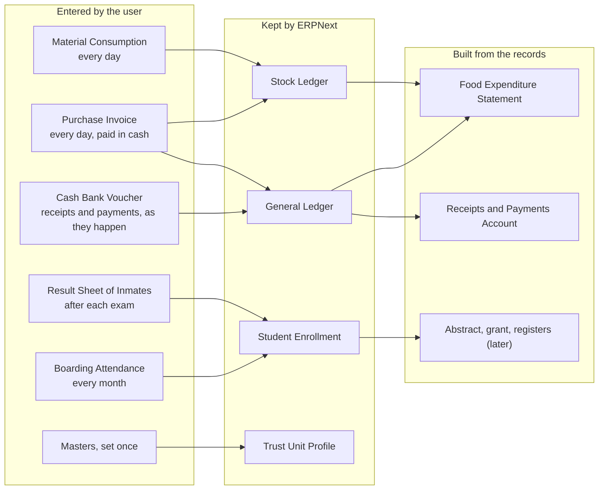
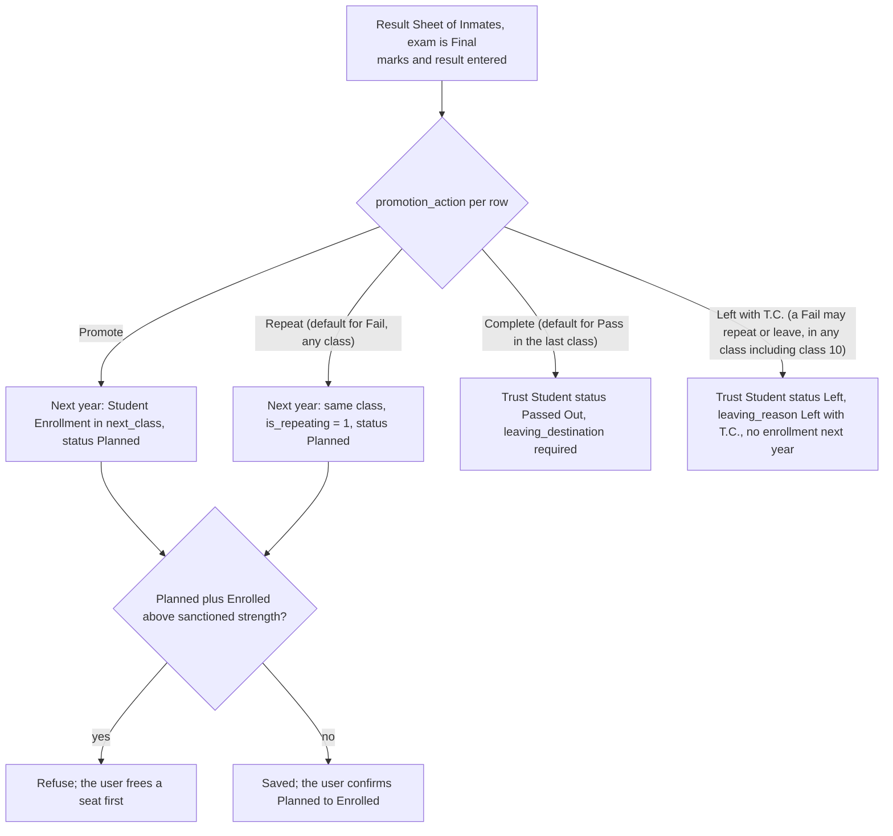

# Zohra Trust ERPNext: build specification

For Claude Code. Build a Frappe app on ERPNext v15 that lets the hostel's staff keep the books, food stock, students, attendance and exam results of the Zohra Minority Girls Hostel, and later produce the half-yearly report the hostel files with the Minority department. This document is the source of truth. Read all of it before writing code.

## 0. Rules for the agent

1. Build in the slices in section 8, in order. A slice is finished only when its acceptance tests pass. Do not start the next slice before that.
2. Use the DocType, field and method names in this document exactly. If a name is wrong or something is missing, stop and ask; do not invent.
3. Everything lives in one app, `zohra_trust`, in developer mode, committed to Git. No configuration is done by hand on a site: DocTypes are saved in the app, custom fields and roles ship as fixtures, later changes ship as patches, and site setup is a script.
4. Prefer standard ERPNext behaviour. Add custom code only where this document says so.
5. Write tests from the filed numbers in section 8. They are the definition of correct.
6. The first slice starts with a short sandbox check (section 8.0). If any check fails, report it before building.
7. Screen labels and printed names follow section 10, which uses the wording of the filed report.

## 1. Goal and scope

**Users.** Any number of users, in these roles: Data Entry, Store and Principal. Do not assume a single user anywhere: no hard-coded user names and no logic that relies on one person entering the data. Screens must stay simple, because some users have low literacy. The CA never logs in. UI language is English. People are called "students" on screens; the department's own words ("inmates") appear on report pages.

**In scope now.** Masters; daily Purchase Invoice and Material Consumption; Cash Bank Voucher for receipts and payments; monthly Boarding Attendance and Food Expenditure Statement; Student Enrollment; Result Sheet of Inmates with promotion; the Receipts and Payments Account report. 

**Later phases (design, do not build yet).** Report Pack, print formats and the merged half-yearly PDF with live preview; Inter-Unit Transfer; other units (Destitute Home, ITI, schools).

## 2. Environment and app layout

- Frappe and ERPNext v15, Python 3.11, MariaDB. App name `zohra_trust`, module `Trust Operations`.
- Fiscal year April to March. Currency INR. Enable Perpetual Inventory is OFF on every Company (cash basis: purchases are expenses at purchase; stock is tracked in quantities only).
- Layout:

```
zohra_trust/
  hooks.py                      # doc_events, fixtures, scheduler none
  trust_operations/doctype/     # the 22 custom DocTypes with controllers
  setup/create_unit.py          # create_unit(company, abbr, ...) one-call site setup
  api/                          # whitelisted methods (fill, copy_yesterday, promote)
  utils/sanction.py             # get_unit_sanction(company, date)
  utils/period.py               # assert_period_open(company, date)
  fixtures/                     # Custom Field, Role, Property Setter, Workspace
  patches/
  tests/                        # golden tests (section 8)
```

## 3. Architecture and data flow

### 3.1 Layers



### 3.2 DocType to DocType flow

| From | To | What moves | Trigger |
|---|---|---|---|
| Item, Account | Purchase Invoice | Item and expense head chosen from lists | Pick on entry |
| Purchase Invoice (paid in cash) | General Ledger | Dr expense, Cr cash | Standard, on submit |
| Purchase Invoice (Update Stock) | Stock Ledger | Quantity in for stock items | Standard, on submit |
| Material Consumption | Stock Entry (Material Issue) | Items and quantities used | Our code, on submit |
| Stock Entry | Stock Ledger | Quantity out | Standard |
| Cash Bank Voucher | Journal Entry | Receipt or payment against an account head | Our code, on submit |
| Journal Entry | General Ledger | Money movement | Standard |
| Trust Student | Student Enrollment | One enrollment per academic year: class, school, register number | Created by hand at admission and by Promote |
| Student Enrollment + Trust Unit Profile | Boarding Attendance | One row per Enrolled student; sanctioned strength and grant rate in force | `fill_rows` button |
| Purchase Invoice + Material Consumption + General Ledger + previous statement | Food Expenditure Statement | Old balance, purchased, consumed, amount-only rows | `fill` button |
| Student Enrollment + Trust Class (Class Exam Marks) | Result Sheet of Inmates | Rows for every Enrolled student; maximum marks for her class and exam | `fill_rows` button |
| Result Sheet of Inmates (Final only) | Student Enrollment (next year) and Trust Student | Promote, Repeat, Complete or Left with T.C. per student | `promote` button |

### 3.3 Promotion flow



## 4. Standard ERPNext pieces

**Standard DocTypes used (25).** Company, Fiscal Year, Account, Cost Center, Item, Item Group, UOM, Warehouse, Supplier, Purchase Invoice, Stock Entry, Journal Entry, GL Entry, Stock Ledger Entry, Bin, Bank Account, Mode of Payment, Employee, Designation, Holiday List, Letter Head, User, Role, User Permission, Accounting Period.

**Custom fields on standard DocTypes (8)**

| DocType | Fieldname | Type | Notes |
|---|---|---|---|
| Item | custom_on_food_statement | Check | Item appears on the Food Expenditure Statement |
| Item | custom_statement_order | Int | Row number on the sheet |
| Account | custom_on_food_statement | Check | Amount-only rows: Vegetables, Mutton, Milk, Fuel, Salaries, GESCOM |
| Account | custom_statement_order | Int | Row number on the sheet |
| Account | custom_rp_head_in | Data | Receipts and Payments row when money comes in, e.g. Loan from Zohra trust |
| Account | custom_rp_head_out | Data | Row when money goes out, e.g. Transfer to Zohra trust |
| Journal Entry | custom_cash_bank_voucher | Link (Cash Bank Voucher), read-only | Marks entries made by a voucher |
| Stock Entry | custom_material_consumption | Link (Material Consumption), read-only | Marks entries made by Material Consumption |

**Site setup (`create_unit`).** Creates the Company with Perpetual Inventory off; accounts below; Warehouse "Hostel Store"; Supplier "Cash purchase"; items; the Trust Unit Profile.

- Receipts (Cash Bank Voucher account heads): income account "Govt. grant received" (rp head in: Govt. grant received); income account "Bank interest" (rp head in: Bank interest); a trust account "Zohra trust" (rp head in: Loan from Zohra trust; rp head out: Transfer to Zohra trust).
- Payments: expense accounts named exactly as the report's rows: Food, Vegetables, Mutton, Milk, Fuel, Detergent, Salaries, GESCOM, Education, Miscellaneous. The Receipts and Payments row (rp head out) is Food for Food, Vegetables, Mutton and Milk; every other account's rp head out is its own name. The printed Food Expenditure Statement rows use these account names, so Salaries and GESCOM print as written in the report.
- Stock items (custom_on_food_statement = 1, in this order): Rice, Jawar, S. Oil, Daal, Sugar, Tamarind, Salt, G. Nut, Chilli, Condiments, Onion, C. Oil, T. Soap, W. Soap.
- Every stock item has an Item Default expense account: Food, except T. Soap and W. Soap, which use Detergent.
- Non-stock items Vegetables, Mutton, Milk, Fuel, each with an Item Default expense account of the same name. Salaries and GESCOM have no items; they are paid through Cash Bank Voucher.

## 5. Custom DocTypes (22)

13 DocTypes and 9 child tables. Submittable: Boarding Attendance, Material Consumption, Cash Bank Voucher, Food Expenditure Statement, Result Sheet of Inmates (each with `amended_from`). Trust Settings is a Single. Child tables are `istable`. Flags: R required, U unique, I indexed, RO read-only.

### 5.1 Trust Settings

Single. Naming: values in tabSingles. Trust-wide settings and the officer bearers (the letterhead).

| Field | Type | Flags | Links to / Notes |
|---|---|---|---|
| trust_name | Data | R | Printed on every report |
| registration_no | Data |  |  |
| current_academic_year | Link |  | → Trust Academic Year. Default for new enrollments |
| correction_window_days | Int |  | Default 1: days a user may still cancel or amend their own entry |
| officer_bearers | Table |  | → Officer Bearer |

### 5.2 Officer Bearer

Child. Naming: parent: Trust Settings. One officer bearer.

| Field | Type | Flags | Links to / Notes |
|---|---|---|---|
| member_name | Data | R |  |
| designation | Select |  | President, Secretary, Joint Secretary, Trustee |
| qualification | Data |  |  |
| phone | Data |  |  |
| sort_order | Int |  | Order on the letterhead |
| is_active | Check |  |  |

### 5.3 Trust School

Master. Naming: school_name. A school the hostel girls attend: Zohra English Medium or Zohra Kannada Medium. A list, not a set of books.

| Field | Type | Flags | Links to / Notes |
|---|---|---|---|
| school_name | Data | R U |  |
| medium | Select | R | English, Kannada |
| company | Link |  | → Company. Only if the school keeps its own books later |
| is_active | Check |  |  |

### 5.4 Trust Exam

Master. Naming: exam_name. An exam in the year: Mid-term, Final.

| Field | Type | Flags | Links to / Notes |
|---|---|---|---|
| exam_name | Data | R U | Mid-term, Final |
| sequence | Int |  | Order in the year |
| is_final | Check |  | Only the Final promotes girls to the next class |

### 5.5 Class Exam Marks

Child. Naming: parent: Trust Class. Maximum marks for one class in one exam. Set by the Karnataka government and the same for the English and Kannada Medium schools.

| Field | Type | Flags | Links to / Notes |
|---|---|---|---|
| exam | Link | R | → Trust Exam |
| max_marks | Int | R | The total for the class and exam, as on the filed result sheet: 250 (classes 1 to 5), 480 (classes 6 to 9), 625 (class 10). Data, never hard-coded; the sheet and the checks read only this field |
| max_marks_per_subject | Int |  | Label Maximum marks per subject. Reference only, from the Education Department: 40 (classes 1 to 5), 60 (classes 6 and 7), 80 (classes 8, 9 and 10). The sheet and the checks never use it and the total is never computed from it |

### 5.6 Trust Class

Master. Naming: class_name. A class with its order and its next class, so promotion is data and not code.

| Field | Type | Flags | Links to / Notes |
|---|---|---|---|
| class_name | Data | R U | Class 8 |
| sequence | Int | R | Order of classes |
| next_class | Link |  | → Trust Class. Blank for the last class |
| exam_marks | Table |  | → Class Exam Marks |

### 5.7 Trust Academic Year

Master. Naming: academic_year_name. An academic year, for example 2026-27.

| Field | Type | Flags | Links to / Notes |
|---|---|---|---|
| academic_year_name | Data | R U |  |
| start_date | Date | R |  |
| end_date | Date | R | Years may not overlap |

### 5.8 Unit Sanction

Child. Naming: parent: Trust Unit Profile. The sanctioned strength and grant rate from a given date. Adding a row changes the limit.

| Field | Type | Flags | Links to / Notes |
|---|---|---|---|
| effective_from | Date | R |  |
| effective_to | Date |  | Blank means current |
| sanctioned_strength | Int | R | The limit on students (150 now) |
| grant_rate | Currency |  | ₹850 per student per month |
| grant_rule | Select |  | Full month per student (default), Pro-rata by hostel days, Per day |
| order_reference | Small Text |  |  |

### 5.9 Trust Unit Profile

Master. Naming: the Company. One per unit: what the unit tracks, its sanction history, and the typed texts.

| Field | Type | Flags | Links to / Notes |
|---|---|---|---|
| company | Link | R U | → Company |
| unit_type | Select | R | Hostel, Destitute Home, School, ITI, Trust |
| tracks_residents | Check |  | Turns on students, enrollments and Boarding Attendance |
| tracks_food_statement | Check |  | Turns on the Food Expenditure Statement |
| tracks_results | Check |  | Turns on the Result Sheet of Inmates |
| ration_warehouse | Link |  | → Warehouse. The hostel store |
| address | Small Text |  |  |
| letter_text | Text Editor |  | Cover letter text; typed once |
| appendix_h_text | Text Editor |  | Appendix – H; free text the user types and edits |
| sanctions | Table |  | → Unit Sanction |

### 5.10 Student Guardian

Child. Naming: parent: Trust Student. A guardian, only when the child has one.

| Field | Type | Flags | Links to / Notes |
|---|---|---|---|
| guardian_name | Data | R | Printed after the child's name on the result sheet |
| relation | Select |  | Father, Mother, Other |
| phone | Data |  |  |

### 5.11 Trust Student

Master. Naming: STU-.#####. The child: who she is and when she joined and left. Class and number live on the enrollment.

| Field | Type | Flags | Links to / Notes |
|---|---|---|---|
| student_name | Data | R | Title field |
| home_unit | Link | R | → Company. The hostel she lives in |
| admission_date | Date | R |  |
| status | Select | R | Active, Left, Passed Out |
| leaving_date | Date |  | Required unless Active; girls leave only at the start or end of an academic year |
| leaving_reason | Small Text |  |  |
| leaving_destination | Select |  | After class 10: Zohra Trust care, Working women hostel, Other |
| tc_number | Data |  | Label T.C. number. Optional, because the certificate may be issued after the result is entered. Shown only when status is Left |
| tc_date | Date |  | Label T.C. date. Optional. Shown only when status is Left |
| has_guardian | Check |  | Shows the guardian details when ticked |
| guardians | Table |  | → Student Guardian |

### 5.12 Student Enrollment

Master. Naming: ENR-{academic year}-{student}. One per student per academic year: class, school and register number. Last year's record is never edited.

| Field | Type | Flags | Links to / Notes |
|---|---|---|---|
| student | Link | R I | → Trust Student |
| student_name | Data | RO | Fetched |
| academic_year | Link | R I | → Trust Academic Year |
| unit | Link | R I | → Company |
| school | Link | R | → Trust School |
| trust_class | Link | R | → Trust Class |
| register_sl_no | Int | R | Unique within unit and year |
| enrollment_date | Date |  |  |
| status | Select |  | Planned, Enrolled, Left, Completed; changes only at a year boundary. Planned holds a seat for next year until a user confirms it |
| is_repeating | Check | RO | Set when she repeats the class |
| previous_enrollment | Link | RO | → Student Enrollment. Last year's record |

### 5.13 Register School Days

Child. Naming: parent: Boarding Attendance. Working days of one school in the month.

| Field | Type | Flags | Links to / Notes |
|---|---|---|---|
| school | Link | R | → Trust School |
| working_days | Int | R | Days the school ran |

### 5.14 Attendance Row

Child. Naming: parent: Boarding Attendance. One girl's days in the month.

| Field | Type | Flags | Links to / Notes |
|---|---|---|---|
| enrollment | Link | R I | → Student Enrollment |
| register_sl_no | Int | RO | Fetched; row order |
| student_name | Data | RO | Fetched |
| trust_class | Link | RO | → Trust Class. Fetched |
| school | Link | RO | → Trust School. Fetched |
| school_working_days | Int | RO | From her school's row above |
| school_days_present | Int |  | Defaults to working days |
| hostel_days | Int |  | Defaults to the calendar days of the month, because girls do not leave mid-year |
| grant_amount | Currency | RO | The full monthly rate, whatever the days stayed |
| absence_reason | Small Text |  |  |

### 5.15 Boarding Attendance

Transaction (submittable). Naming: BAT-{abbr}-{YYYY}-{MM}. One per unit per month: hostel and school days per girl; the grant per row.

| Field | Type | Flags | Links to / Notes |
|---|---|---|---|
| company | Link | R | → Company |
| month | Select | R |  |
| year | Int | R |  |
| academic_year | Link | RO | → Trust Academic Year. Derived |
| period_start | Date | RO |  |
| period_end | Date | RO |  |
| calendar_days | Int | RO |  |
| sanctioned_strength | Int | RO | Copied from the Unit Sanction in force |
| grant_rate | Currency | RO | Copied |
| grant_rule | Select | RO | Copied |
| school_days | Table |  | → Register School Days |
| rows | Table |  | → Attendance Row. Filled by a button |
| students_on_roll | Int | RO | Stops above the sanctioned strength |
| total_hostel_days | Int | RO | The abstract's hostel attendance |
| total_school_days_present | Int | RO |  |
| total_grant | Currency | RO |  |
| amended_from | Link |  | → Boarding Attendance |

### 5.16 Material Consumption Item

Child. Naming: parent: Material Consumption. One item used.

| Field | Type | Flags | Links to / Notes |
|---|---|---|---|
| item_code | Link | R | → Item. Only items flagged for the statement |
| item_name | Data | RO |  |
| uom | Link | RO | → UOM |
| qty | Float | R |  |

### 5.17 Material Consumption

Transaction (submittable). Naming: MC-.YYYY.-.#####. What the kitchen used that day. Opens with yesterday's items; makes one Stock Entry (Material Issue) on submit.

| Field | Type | Flags | Links to / Notes |
|---|---|---|---|
| company | Link | R | → Company |
| posting_date | Date | R | One per unit per day |
| warehouse | Link | RO | → Warehouse. From the unit profile |
| items | Table |  | → Material Consumption Item |
| stock_entry | Link | RO | → Stock Entry. Created on submit |
| amended_from | Link |  | → Material Consumption |

### 5.18 Cash Bank Voucher

Transaction (submittable). Naming: CBV-.YYYY.-.#####. Receipts and payments as they happen. Makes one Journal Entry on submit.

| Field | Type | Flags | Links to / Notes |
|---|---|---|---|
| company | Link | R | → Company |
| voucher_type | Select | R | Receipt, Payment |
| posting_date | Date | R |  |
| mode | Select | R | Cash, Bank |
| bank_account | Link |  | → Bank Account. Required when mode is Bank |
| account_head | Link | R | → Account. Income, expense or trust account of that Company. Receipts: Govt. grant received, Loan from Zohra trust, Bank interest |
| party_type | Select |  | Supplier, Employee |
| party | Dynamic Link |  | Only for party accounts |
| amount | Currency | R | Greater than zero |
| narration | Small Text |  |  |
| reference_no | Data |  | Cheque number or UTR |
| paper_book | Data |  |  |
| paper_no | Int |  | Paper receipt number |
| journal_entry | Link | RO | → Journal Entry. Created on submit |
| amended_from | Link |  | → Cash Bank Voucher |

### 5.19 Food Expenditure Statement Line

Child. Naming: parent: Food Expenditure Statement. One item or head across the sheet's columns.

| Field | Type | Flags | Links to / Notes |
|---|---|---|---|
| line_type | Select | RO | Item, Expense Head |
| item_code | Link |  | → Item. Column 2 |
| account | Link |  | → Account. Column 2, amount-only rows |
| uom | Link | RO | → UOM |
| old_qty | Float | RO | Col 3; the real stock at the end of the day before the period starts |
| old_rate | Currency | RO | Col 4 |
| old_amount | Currency | RO | Col 5 |
| purchased_qty | Float | RO | Col 6, from the month's Purchase Invoices |
| purchased_rate | Currency | RO | Col 7 |
| purchased_amount | Currency | RO | Col 8 |
| total_qty | Float | RO | Col 9 |
| total_amount | Currency | RO | Col 10 |
| consumed_qty | Float | RO | Col 11, from the month's Material Consumption |
| expenditure_amount | Currency | RO | Col 12, by the client's formula |
| balance_qty | Float | RO | Col 13 |
| balance_amount | Currency | RO | Col 14 |

### 5.20 Food Expenditure Statement

Transaction (submittable). Naming: FES-{abbr}-{YYYY}-{MM}. The monthly 15-column sheet, built from the month's purchases and consumption; a user checks and submits.

| Field | Type | Flags | Links to / Notes |
|---|---|---|---|
| company | Link | R | → Company |
| month | Select | R |  |
| year | Int | R |  |
| period_start | Date | RO |  |
| period_end | Date | RO |  |
| warehouse | Link | RO | → Warehouse |
| is_opening | Check |  | First statement only |
| previous_statement | Link | RO | → Food Expenditure Statement. The last submitted one, whatever the month |
| lines | Table |  | → Food Expenditure Statement Line. Filled by a button |
| total_opening | Currency | RO |  |
| total_purchase | Currency | RO |  |
| total_available | Currency | RO |  |
| total_expenditure | Currency | RO |  |
| total_closing | Currency | RO |  |
| amended_from | Link |  | → Food Expenditure Statement |

### 5.21 Result Row

Child. Naming: parent: Result Sheet of Inmates. One girl's result in the exam.

| Field | Type | Flags | Links to / Notes |
|---|---|---|---|
| enrollment | Link | R I | → Student Enrollment |
| register_sl_no | Int | RO | Fetched |
| student_name | Data | RO | Fetched |
| guardian_name | Data | RO | Fetched; blank if no guardian |
| trust_class | Link | RO | → Trust Class. Fetched |
| school | Link | RO | → Trust School. Fetched |
| max_marks | Int | RO | From her class and this exam |
| marks_obtained | Int |  |  |
| result | Select |  | Pass, Fail, Absent; entered, not calculated |
| promotion_action | Select |  | Promote, Repeat, Complete, Left with T.C.; a Fail defaults to Repeat in every class, including class 10, and may instead be set to Left with T.C. |
| leaving_destination | Select |  | Asked when the action is Complete (not needed for Left with T.C.): Zohra Trust care, Working women hostel, Other; copied to the Trust Student |

### 5.22 Result Sheet of Inmates

Transaction (submittable). Naming: RSI-{abbr}-{academic year}-{exam}. One per unit and exam: every hostel girl, whichever school. After the Final it makes next year's enrollments.

| Field | Type | Flags | Links to / Notes |
|---|---|---|---|
| company | Link | R | → Company |
| academic_year | Link | R | → Trust Academic Year |
| exam | Link | R | → Trust Exam |
| exam_date | Date |  |  |
| rows | Table |  | → Result Row. Filled from this year's enrollments |
| appeared | Int | RO |  |
| passed | Int | RO |  |
| failed | Int | RO |  |
| promotion_done | Check | RO | Set once next year's enrollments are made |
| amended_from | Link |  | → Result Sheet of Inmates |

### 5.23 Select options

| DocType.field | Options |
|---|---|
| Trust Unit Profile.unit_type | Hostel, Destitute Home, School, ITI, Trust |
| Unit Sanction.grant_rule | Full month per student, Pro-rata by hostel days, Per day |
| Trust Student.status | Active, Left, Passed Out |
| Trust Student.leaving_destination, Result Row.leaving_destination | Zohra Trust care, Working women hostel, Other |
| Student Guardian.relation | Father, Mother, Other |
| Trust School.medium | English, Kannada |
| Officer Bearer.designation | President, Secretary, Joint Secretary, Trustee |
| Student Enrollment.status | Planned, Enrolled, Left, Completed |
| Boarding Attendance.month, Food Expenditure Statement.month | January to December |
| Cash Bank Voucher.voucher_type | Receipt, Payment |
| Cash Bank Voucher.mode | Cash, Bank |
| Cash Bank Voucher.party_type | Supplier, Employee |
| Food Expenditure Statement Line.line_type | Item, Expense Head |
| Result Row.result | Pass, Fail, Absent |
| Result Row.promotion_action | Promote, Repeat, Complete, Left with T.C. |

Show `guardians` only when `has_guardian` is ticked. Show `leaving_destination` only when the student's status is Left or Passed Out.

## 6. Logic to implement

**Helpers**
- `get_unit_sanction(company, date)`: from Trust Unit Profile.sanctions, the row with `effective_from <= date` and (`effective_to` empty or `>= date`), latest `effective_from` wins. Returns strength, rate and rule. The sanctioned strength is never hard-coded; 150 is only today's value.
- `assert_period_open(company, date)`: raises if an Accounting Period closes that date. Call it in `validate` of every custom transaction.
- Correction window: on cancel or amend of a document the user created, refuse if older than `Trust Settings.correction_window_days` unless the user has the Principal role. One `doc_events` hook covers the standard and custom transactions.

**Trust Student.** `home_unit` required. `leaving_date` required unless status is Active.

**Student Enrollment.** Name is `ENR-{academic_year}-{student}`, which makes a second enrollment for the same year impossible. `validate`: `register_sl_no` unique within unit and academic year; count of enrollments with status Planned or Enrolled for the same unit and year, including this one, must not exceed `get_unit_sanction(unit, enrollment_date or today).strength`; else raise "Sanctioned strength reached".

**Boarding Attendance.** Name `BAT-{abbr}-{YYYY}-{MM}`; one per company and month.
- `fill_rows()`: academic_year = the Trust Academic Year containing the period; take Student Enrollments of the company and year with status Enrolled, ordered by `register_sl_no`; `calendar_days` = days in the month; `hostel_days` = `calendar_days` (girls do not leave mid-year; if `enrollment_date` falls inside the month, count from that date); `school_working_days` = the working days of her school from the `school_days` table; `school_days_present` = that value; copy sanctioned strength, grant rate and rule from `get_unit_sanction(company, period_end)`; `grant_amount` = the full monthly rate for every row when the rule is Full month per student.
- `validate`: `students_on_roll` must not exceed the sanctioned strength; days must not exceed calendar days and working days; call `assert_period_open`. Totals: `total_hostel_days`, `total_school_days_present`, `total_grant`.

**Material Consumption.** One per company and `posting_date` (docstatus below 2).
- `copy_yesterday(company, posting_date)` (whitelisted): returns the items and quantities of the latest earlier Material Consumption.
- `on_submit`: make a Stock Entry, purpose Material Issue, from the unit's `ration_warehouse`, one line per item; set `custom_material_consumption` on it and `stock_entry` on this document. `on_cancel`: cancel that Stock Entry.

**Cash Bank Voucher.** `on_submit`: make a Journal Entry. Receipt: Dr the company's cash account (mode Cash) or the Bank Account's GL account (mode Bank), Cr `account_head`. Payment: the reverse. Require `party_type` and `party` when the account is a payable or receivable. Set `custom_cash_bank_voucher` on the entry and `journal_entry` here. `on_cancel`: cancel the entry. Block cancelling or amending a Journal Entry that has `custom_cash_bank_voucher` set, except through the voucher.

**Food Expenditure Statement.** Name `FES-{abbr}-{YYYY}-{MM}`. `fill()`:
1. `previous_statement` = the latest submitted statement of the company with `period_end` before this `period_start`, whatever the month (months may be skipped). `is_opening` only means that no previous statement is required; it never means that old values are typed.
2. One line per Item with `custom_on_food_statement`, in `custom_statement_order`: `old_qty` = the real stock quantity of the item in the unit's warehouse at 23:59:59 on the day before `period_start` (the Stock Ledger, with the time given so that entries made late that day count); `old_rate` = the closing `balance_amount / balance_qty` of the previous statement for that item, or the stock valuation rate when there is no earlier statement (or it closed with no quantity); `old_amount` = `old_qty * old_rate`; `purchased_qty` and `purchased_amount` = sums over the month's submitted Purchase Invoice items for that item and company; `purchased_rate` = amount / quantity; `consumed_qty` = sum over the month's submitted Material Consumption items.
3. `total_qty = old_qty + purchased_qty`; `total_amount = old_amount + purchased_amount`.
4. `expenditure_amount`: if `consumed_qty == total_qty` then `total_amount`; else if `purchased_qty > 0` then `consumed_qty * purchased_rate`; else `consumed_qty * old_rate`. Balance quantity and amount are total minus consumed and total minus expenditure.
5. One line per Account with `custom_on_food_statement`: `purchased_amount` = net debit in the month from GL Entry for that account and company (this picks up Vegetables, Mutton, Milk and Fuel from purchase invoices, and Salaries and GESCOM from vouchers); total, expenditure and purchased are equal; balance is zero.
6. Totals: `total_opening` sum of `old_amount`; `total_purchase` sum of `purchased_amount`; `total_available` the two added; `total_expenditure`; `total_closing` sum of `balance_amount`.
- `validate` on submit: previous statement exists unless `is_opening`; warn if an item's `balance_qty` differs from the Bin quantity at period end.

**Result Sheet of Inmates.** Name `RSI-{abbr}-{academic year}-{exam}`.
- `fill_rows()`: Enrolled students of the company and year, ordered by `register_sl_no`; `max_marks` from the student's Trust Class, Class Exam Marks row for this exam; `guardian_name` = the first guardian's name when `has_guardian`.
- Defaults for `promotion_action`: Pass and the class has a `next_class` → Promote; Pass and no `next_class` → Complete; Fail → Repeat (every class, including the last); Absent → left blank for the user.
- `validate`: `marks_obtained` not above `max_marks`; `result` required on submit; `appeared`, `passed`, `failed` totals.
- `promote()` (button, only when the exam has `is_final`, docstatus is 1 and `promotion_done` is 0): for each row, make the Student Enrollment for the next Trust Academic Year (the one starting after this year ends), status Planned, `previous_enrollment` set, `register_sl_no` the next free number: Promote uses the class's `next_class`; Repeat keeps the class and sets `is_repeating`. Complete: Trust Student status Passed Out, `leaving_date` the year's end date, `leaving_destination` required, enrollment status Completed. Left with T.C.: Trust Student status Left, `leaving_date` the year's end date, `leaving_reason` "Left with T.C.", enrollment status Left, and no enrollment is made for next year (`tc_number` and `tc_date` may be filled later on the Trust Student). Set `promotion_done`. Never edit last year's enrollment except its status.

**Receipts and Payments Account (script report).** Filters: company, from_date, to_date. Opening and closing cash and bank from the GL at those dates. For every voucher in the period that touches a cash or bank account, group the counter-accounts by `custom_rp_head_in` when money came in and by `custom_rp_head_out` when it went out. Output two columns (Receipts, Payments) with the opening and closing balances, so that total receipts equal total payments.

**Roles.** Data Entry: create, write and submit own Material Consumption, Cash Bank Voucher, Boarding Attendance, Food Expenditure Statement, Result Sheet of Inmates, Purchase Invoice and Student Enrollment; read the masters. Store: Purchase Invoice, Material Consumption and Food Expenditure Statement. Principal: everything, cancel at any time, edit masters, close months. A User Permission on Company limits each user to their unit. Any number of users can hold each role. Every entry records who made it (the standard owner field), and Track Changes is on for all custom DocTypes.

## 7. Defaults chosen where Zohra has not answered

- A student who joins mid-year counts from her enrollment date; the grant is still the full monthly rate for her row.
- The food statement chain skips months freely; a difference between the system stock and the paper is only a warning.
- A girl with no guardian prints only her name; this is parked.
- Several users may enter data on the same day. Material Consumption allows one document per company and day, so a second user who opens that day gets the existing draft instead of a duplicate.
- Users can cancel or amend only their own documents inside the correction window; the Principal can do it for anyone's.
- Student Enrollment has the extra status Planned so Promote can save next year's enrollments without taking effect.

- No statement is made for April and May. April's purchases are bought in March and entered as ordinary Purchase Invoices dated in March, so they fall inside March's statement. The kitchen's daily Material Consumption continues all year, and the old balance of every statement is the real stock at the start of its period.
- Assumption: the Mid-term totals per class are the same as the Final totals, until Zohra says otherwise.
- The grant: the department pays it once every six months, as one receipt. It is ₹850 per student per month, paid in full and not pro-rated, whatever the days stayed. The half-yearly receipt is entered with a Cash Bank Voucher on the account "Govt. grant received". The Grant Bill (later) sums the six months of Boarding Attendance. The grant bill format is still to come from Zohra.

## 8. Build order and acceptance tests

### 8.0 Sandbox check (before slice 1)

Create a throwaway site and confirm: (a) with Perpetual Inventory off, a Purchase Invoice paid in cash with Update Stock debits the expense and adds stock quantity, and a Stock Entry Material Issue posts nothing to GL Entry; (b) an Accounting Period closes standard documents for a month; (c) a User Permission on Company limits a user; (d) the PDF engine renders Kannada text; (e) a portrait and a landscape PDF can be merged. Report the result.

### Slice 1: masters, students, Boarding Attendance
Build Trust Settings, Trust School, Trust Exam, Trust Class, Trust Academic Year, Trust Unit Profile, Trust Student, Student Enrollment, Boarding Attendance and their child tables, and `create_unit`.

Tests: with 100 Enrolled students and a sanctioned strength of 150 from 1 April 2026: June (30 days) gives `total_hostel_days` 3,000; July 3,100; August 3,100; September 3,000. A 151st enrollment is refused; after adding a Unit Sanction row of 160 effective from a later date, an enrollment dated after it is accepted and one dated before it is still refused. `total_grant` for a month is 100 times the rate in force.

### Slice 2: purchases, consumption, Food Expenditure Statement
Build Material Consumption, the custom fields on Item, Account and Stock Entry, and the Food Expenditure Statement.

Seed the hostel's real stock with the old balances below (a Stock Reconciliation at 31 May with a valuation rate of old amount / old quantity for each item), make the opening statement, add June purchase invoices, and add Material Consumption entries that sum to the consumed quantities. The filled June statement must match:

| Item | Old qty | Old amount | Purchased qty | Purchased amount | Consumed | Expenditure | Balance qty | Balance amount |
|---|---|---|---|---|---|---|---|---|
| Rice | 50 | 2,450 | 1,200 | 58,800 | 1,050 | 51,450 | 200 | 9,800 |
| Jawar | 35 | 1,050 | 600 | 18,000 | 450 | 13,500 | 185 | 5,550 |
| S. Oil | 3 | 450 | 30 | 4,500 | 30 | 4,500 | 3 | 450 |
| Daal | 3 | 240 | 30 | 2,400 | 30 | 2,400 | 3 | 240 |
| Sugar | 6 | 330 | 30 | 1,650 | 32 | 1,760 | 4 | 220 |
| Tamarind | 0 | 0 | 30 | 2,250 | 28 | 2,100 | 2 | 150 |
| Salt | 1 | 20 | 30 | 600 | 30 | 600 | 1 | 20 |
| G. Nut | 0 | 0 | 30 | 3,600 | 30 | 3,600 | 0 | 0 |
| Chilli | 0 | 0 | 30 | 4,500 | 30 | 4,500 | 0 | 0 |
| Condiments | 11 | 2,200 | 20 | 4,000 | 15 | 3,000 | 16 | 3,200 |
| Onion | 20 | 400 | 50 | 1,000 | 60 | 1,200 | 10 | 200 |
| C. Oil | 2 | 400 | 40 | 8,000 | 24 | 4,800 | 18 | 3,600 |
| T. Soap | 0 | 0 | 300 | 4,800 | 300 | 4,800 | 0 | 0 |
| W. Soap | 0 | 0 | 300 | 4,200 | 300 | 4,200 | 0 | 0 |

Amount-only rows for June: Vegetables 15,370; Mutton 22,700; Fuel 11,780; Salaries 11,000; Milk and GESCOM nil. Expected totals: `total_opening` 7,540; `total_purchase` 1,79,150; `total_available` 1,86,690; `total_expenditure` 1,63,260; `total_closing` 23,430.

Then July (old balance from the real stock, rated at June's closing rate) must give totals: purchase 1,37,700; available 1,61,130; expenditure 1,48,865; closing 12,265. September: August is not entered, so create September as an opening statement (`is_opening`) with real stock set to the filed old balances (a Stock Reconciliation at 31 August), which total 22,640; then purchase 2,24,388; available 2,47,028; expenditure 1,63,988.50; closing 83,040. Also test: submitting Material Consumption lowers the Bin quantity and cancelling restores it; `copy_yesterday` returns yesterday's lines; two Material Consumptions on one day are refused.

### Slice 3: receipts and payments
Build Cash Bank Voucher and the Receipts and Payments Account report.

Tests: submitting a Receipt makes a Journal Entry with the right sides; cancelling cancels it; cancelling the Journal Entry directly is refused. For 1 April to 30 September 2026 with the filed figures loaded (opening cash 682, bank 6,34,446.84; loan from Zohra trust 12,30,000; bank interest 4,779; payments Food 5,63,825, Fuel 37,780, Detergent 47,400, Salaries 48,000, Transfer to Zohra trust 7,00,000), closing cash is 33,677 and closing bank 4,39,225, and total receipts equal total payments (18,69,907, ignoring the 84 paise).

### Slice 4 to 6 (outline; design is done separately)
4. Report Pack, the page templates and the live preview screen, with the static pages (letter, Appendix – H, list of officer bearer, list of staff members).
5. Result Sheet of Inmates, Trust Class marks, and `promote()`. Tests: Pass in classes 1 to 9 moves up; Fail repeats with `is_repeating`; Pass in the last class completes with a destination; Left with T.C. closes the record with no next-year enrollment, in any class including class 10; Repeat in class 10 stays allowed; promotion is refused above the sanctioned strength; last year's enrollment is unchanged.
6. The full merged report, tried on the June to September 2026 data and compared with the filed pages 2 to 7.

## 9. Hand-offs

Answered by Zohra: the opening balance follows the real stock; for now only the administrator enters the marks of all students; new students join only at the start of a new academic year; the grant is ₹850 per student per month, with no other part.

Open. Ask the product owner before building anything that depends on these:

- The Mid-term totals per class.
- The diet scale table, and whether it differs by age or class.
- The grant bill sample.
- Whether the report filed last March has Food Expenditure Statements for March and April. The October report has statements for June to September only, so it cannot answer this.

Pending, do not build: **Diet scale.** Zohra has said both that no diet scale is prescribed and that one exists from a nutrition board, and is not sure of the table. When a table arrives, the plan is a Diet Scale DocType with a child table of items and quantity per student per day, and a "Fill from diet scale" button on Material Consumption next to Copy yesterday.

## 10. Names and labels that must match the report

The filed report is the department's own form, so its wording is used on screens and pages. Set the Frappe `label` of each field below to the text shown. Field names in code stay as in section 5.

### 10.1 Page and enclosure names (use exactly)

The letter lists its enclosures as: Appendix – H; List of officer bearer; Boarding attendance; Food expenditure statement; List of staff members; Grant bill; Abstract of boarding and attendance. The other pages are titled: Receipts and payments account for the period; Abstract statement of attendance; List of staff; Result sheet of inmates; and the Kannada-headed School: College attendance register. The filed receipts page prints the typo "RECIEPTS"; print "RECEIPTS" unless told otherwise.

The unit is written three ways in the report (Minority, Minorities, minority girls' hostel). Use "Zohra Minority Girls Hostel".

### 10.2 Field labels

| DocType.field | Label |
|---|---|
| Boarding Attendance.sanctioned_strength | Sanction strength |
| Boarding Attendance.total_hostel_days, Attendance Row.hostel_days | Hostel attendance |
| Boarding Attendance.total_school_days_present, Attendance Row.school_days_present | School attendance |
| Attendance Row.register_sl_no | Sl. No. |
| Attendance Row.absence_reason | Reasons for absence |
| Register School Days.working_days | Days school ran |
| Food Expenditure Statement Line.item_code | Name of food grains |
| Food Expenditure Statement Line.old_qty, old_rate, old_amount | Old balance: Quantity, Rate /kg, Amount (₹) |
| Food Expenditure Statement Line.purchased_qty, purchased_rate, purchased_amount | Purchased during the month: Quantity, Rate, Amount (₹) |
| Food Expenditure Statement Line.total_qty, total_amount | Total: Quantity, Amount (₹) |
| Food Expenditure Statement Line.consumed_qty, expenditure_amount | Expenditure: Quantity, Amount (₹) |
| Food Expenditure Statement Line.balance_qty, balance_amount | Balance: Quantity, Amount (₹) |
| Food Expenditure Statement.total_opening | Opening balance |
| Food Expenditure Statement.total_purchase | Monthly purchase |
| Food Expenditure Statement.total_available | Total |
| Food Expenditure Statement.total_expenditure | Monthly expenditure |
| Food Expenditure Statement.total_closing | remaining balance |
| Result Row.register_sl_no | SL. NO |
| Result Row.student_name with guardian_name | NAME & FATHER NAME (the name, then the guardian's name when there is one) |
| Result Row.trust_class | CLASS |
| Result Row.max_marks | TOTAL MARKS |
| Result Row.marks_obtained | MARKS OBTAINED |
| Result Row.result | RESULT |

The Food Expenditure Statement page header prints "Sanctioned Strength-" with the strength in force, then "Month-" and "Year-".

The Receipts and Payments Account has these rows. Receipts: Opening balance (Cash, Bank); Loan from Zohra trust; Bank interest; Govt. grant received. Payments: Food; Fuel; Detergent; Salaries; Education; Miscellaneous; Transfer to Zohra trust; Closing balance (Cash, Bank).

### 10.3 Names that are ours and never print

Material Consumption (the client's own word for daily use), Cash Bank Voucher, Trust Student, Student Enrollment, Trust Unit Profile, Trust Class, Trust Exam, Trust School, Trust Academic Year, Trust Settings, Unit Sanction. On screens a child is a "student"; the department's word "inmates" appears only on report pages.