# Zohra Trust: how the work flows

This guide follows one full cycle in the order the work really happens. Every screenshot was taken during a real run on a clean hostel ("Demo Hostel", six girls, June 2026). The numbers in the examples are from that run.

**The rule of the whole system:** you enter things once, as they happen. The monthly sheets and the report are built from what you entered. You never type the same number twice.

```
Set up once          Every day               Every month            Once a year          Every half-year
-----------          ---------               -----------            -----------          ---------------
Trust Settings       Purchase Invoice        Boarding Attendance    Result Sheet         Report Pack
Unit Profile         Material Consumption    Food Statement         Promote              (preview, PDF)
Students             Cash Bank Voucher       Receipts & Payments
Opening stock
```

**Buttons used everywhere:** Save (Ctrl+S) keeps a draft. **Submit** makes it final. **Cancel** takes a final document back (see "Fixing a mistake" at the end).

---

## 1. Set up once

Done by the administrator when a hostel starts using the system. A developer runs `create_unit` once for the hostel (it makes the company, accounts, store, items and the sanctioned strength of 150 at ₹850). Then the office fills in the details below.

### 1.1 Trust Settings: the trust and its officer bearers
Open **Trust Settings**. Type the trust name and registration number, choose the current academic year, and list the officer bearers (name, designation, qualification, phone, sort order). The letterhead on the report prints these, in sort order. Untick **Is Active** for someone who has left.

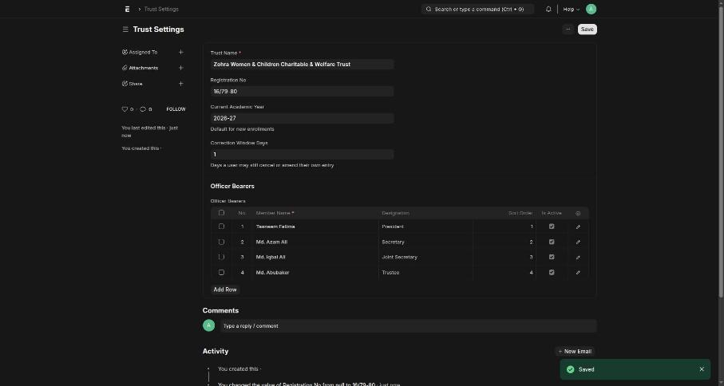

### 1.2 Trust Unit Profile: the hostel's address and typed texts
Open **Trust Unit Profile**, then the hostel. Check the address, the ration warehouse (Hostel Store) and the sanction history (150 girls, ₹850 each from 1 April 2026). Further down, type the **Letter Text** (the cover letter) and the **Appendix – H Text**. In the letter you may write `{{ from_date }}`, `{{ to_date }}` or `{{ period }}`; the report fills them in.

When the department changes the strength or the rate, **add a new row** to Sanctions with the date it starts. Never edit the old row.

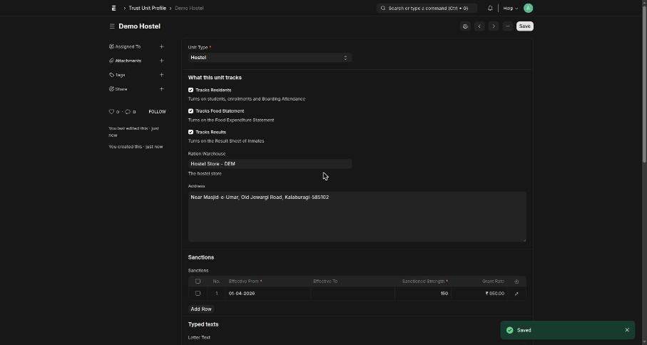

### 1.3 Students and enrollments
Each girl has two records.

1. **Trust Student**: name, hostel, admission date. Tick **Has Guardian** and add the father's name if there is one (it prints on the result sheet).

   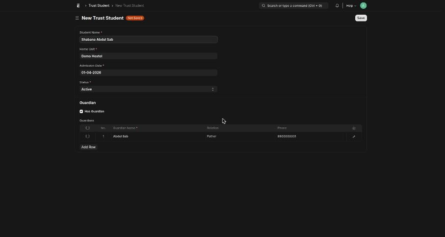

2. **Student Enrollment**: one per girl per academic year: the student, the year, her class, her school, her register number and the date. Status **Enrolled** means she is in the hostel this year. A new girl can only join at the start of an academic year. The system refuses a girl above the sanctioned strength.

   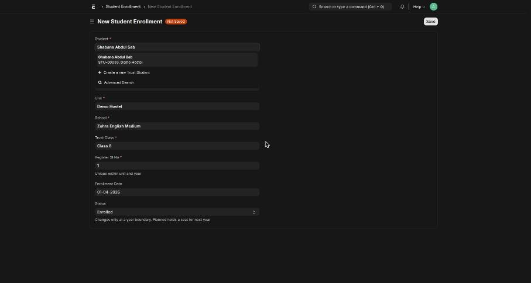

The list shows everyone enrolled.

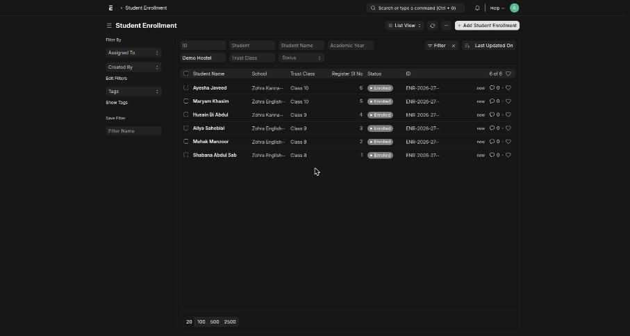

### 1.4 Opening stock (go-live)
Count the food in the store on the day before the first statement's month. Enter it as a **Stock Reconciliation**: purpose **Opening Stock**, one row per item with the quantity **and the valuation rate**. Without a rate the opening amount on the food statement is zero. Here: Rice 50 kg at ₹49 and Sugar 6 kg at ₹55, dated 31 May 2026.

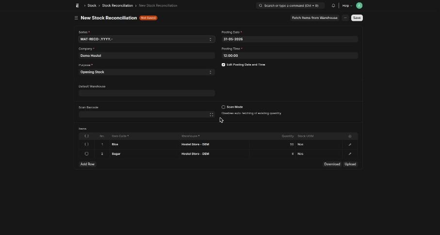
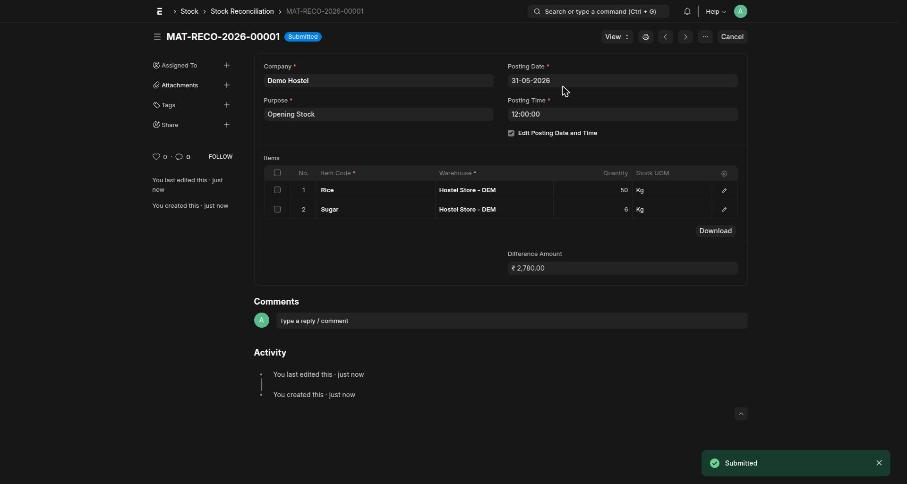

---

## 2. Every day

### 2.1 Purchases: Purchase Invoice
For each day's shopping, make a **Purchase Invoice**: supplier **Cash purchase**, the date, tick **Update Stock** and set the warehouse to **Hostel Store**, tick **Is Paid** with mode **Cash** and the cash account. Add the items. Rice, Sugar and the other food items add to stock. Vegetables, Mutton, Milk and Fuel are not stocked; they only count as spending. Submit.

Here: Rice 100 × ₹49, Sugar 20 × ₹55, Vegetables ₹1,500 = ₹7,500, paid in cash.

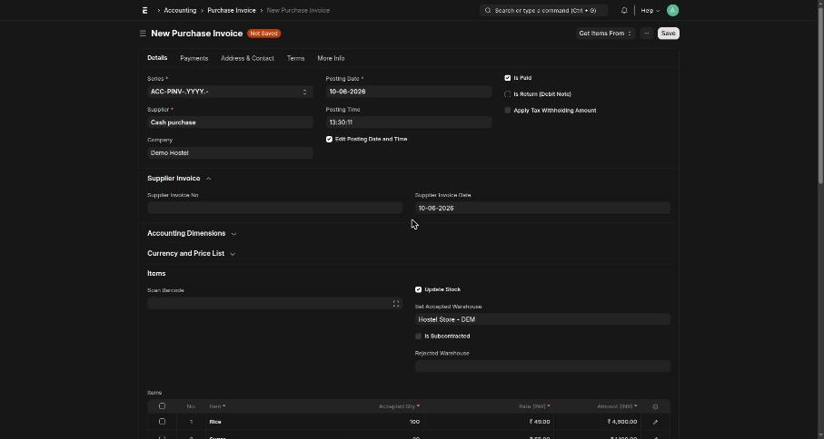
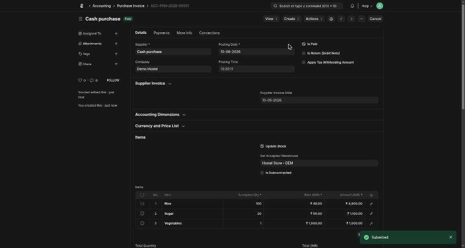

### 2.2 Kitchen use: Material Consumption
Once a day, record what the kitchen used. Click **Copy Yesterday** to start from yesterday's items, change the quantities if they differ, Save, Submit. Only one entry per day per hostel is allowed. Submitting takes the items out of stock.

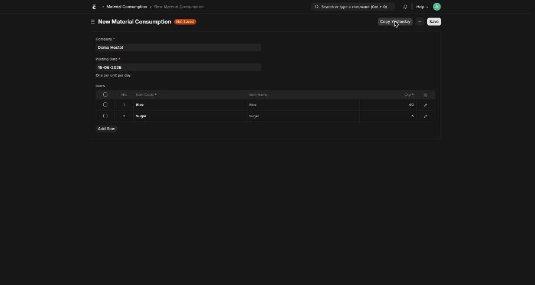
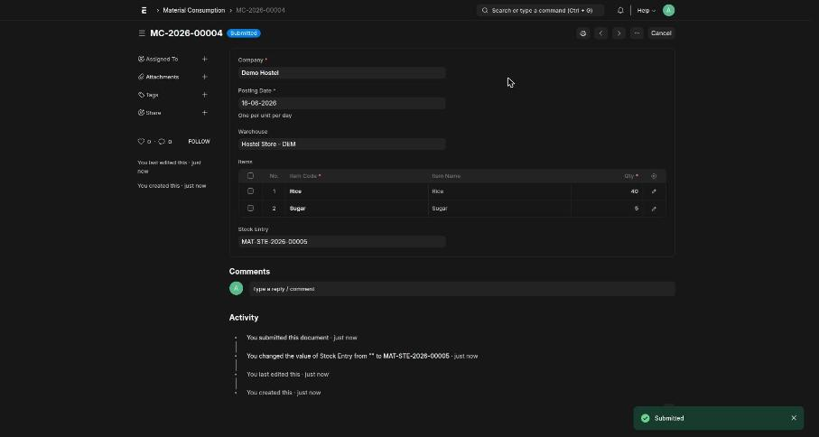

### 2.3 Money in and out: Cash Bank Voucher
Every receipt and payment that is not a shop purchase is a **Cash Bank Voucher**: **Receipt** or **Payment**, the date, **Cash** or **Bank**, the **Account Head** (for example Govt. grant received, Salaries, Loan from Zohra trust) and the amount. For a bank voucher, also choose the bank account. Submit.

The department pays the grant once every six months, as one receipt: ₹850 × girls × months, in full. Here: 6 × 850 × 6 = ₹30,600 on **Govt. grant received**. Salaries of ₹11,000 were a Payment on **Salaries**.

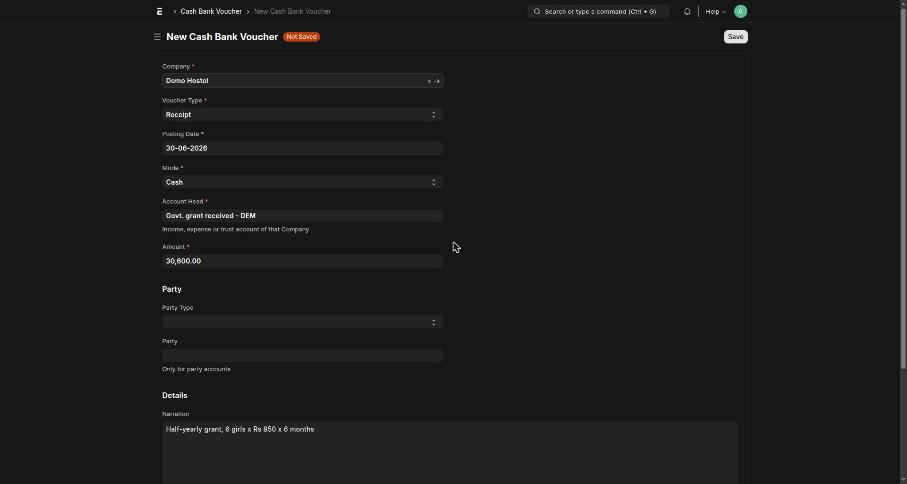
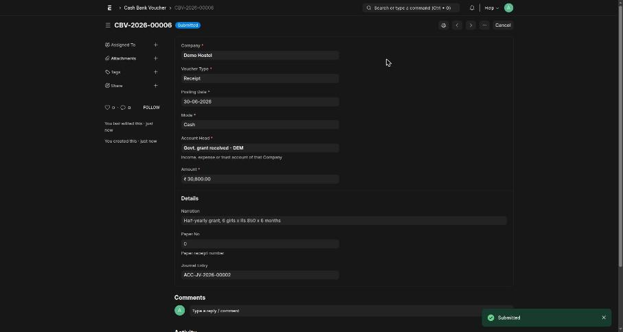

Submitting a voucher makes its Journal Entry automatically. Never edit or cancel that Journal Entry yourself; cancel the voucher.

---

## 3. Every month

### 3.1 Boarding Attendance
At the end of the month: new **Boarding Attendance**, choose the hostel and month. In **School working days** add one row per school and the days it ran (here English 25, Kannada 24). Click **Fill Girls**. Every enrolled girl appears with her school days and hostel days (all days of the month). Change a girl's days only if she was absent, and write the reason. Save and check the totals, then Submit.

Here: 6 girls, 180 hostel days, ₹5,100 grant (6 × ₹850).

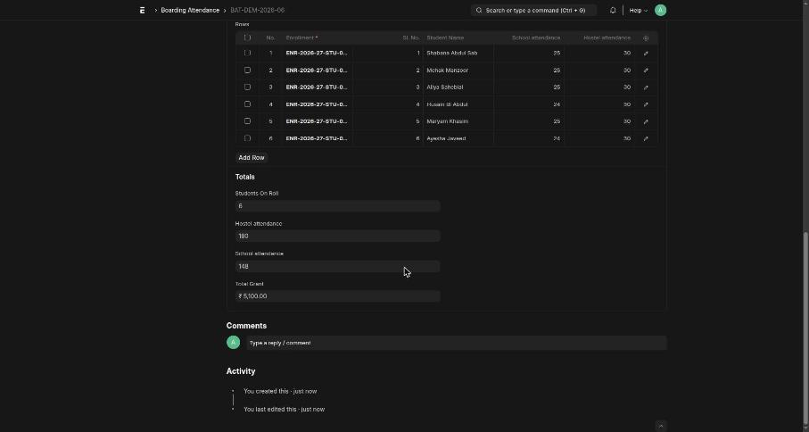
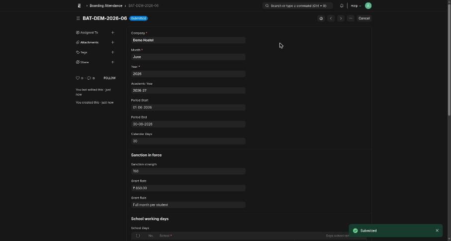

### 3.2 Food Expenditure Statement
After the month's purchases and kitchen entries are in, make the **Food Expenditure Statement**: hostel, month, and tick **Is Opening** only for the very first statement. Click **Fill**. Nothing is typed:

- **Old balance** is the real stock at the end of the day before the month (quantity), valued at the last statement's closing rate (or the stock rate for the first statement).
- **Purchased** comes from the month's Purchase Invoices; **Expenditure quantity** from Material Consumption.
- Vegetables, Mutton, Milk, Fuel, Salaries and GESCOM come from the money actually spent in the month.

Check the lines and the totals, then Submit. A yellow message after submitting means the statement and the stock differ; look at it before filing.

Here: opening ₹2,780; purchases ₹18,500 (stock ₹6,000, vegetables ₹1,500, salaries ₹11,000); spent ₹16,970; closing ₹4,310. Rice used 80 kg at ₹49 = ₹3,920, 70 kg left.

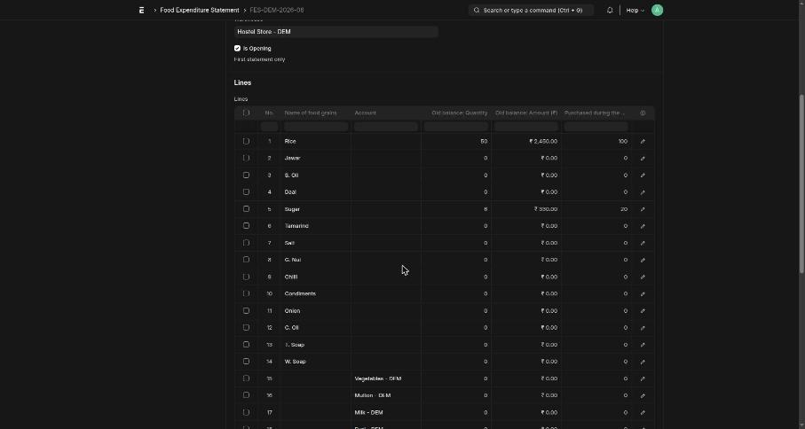
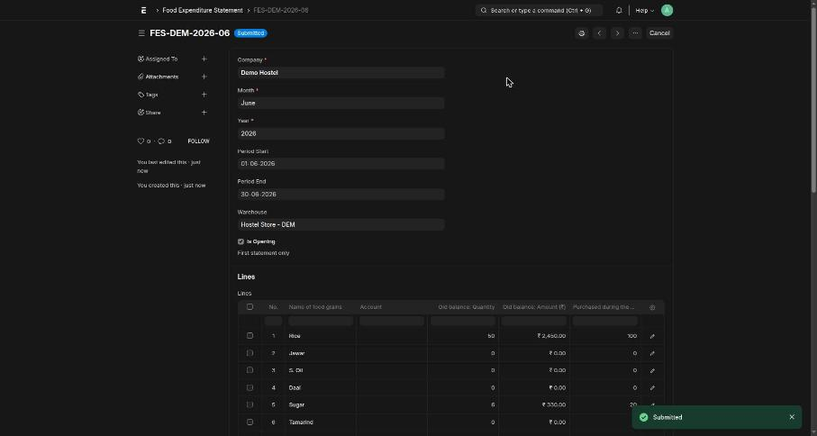

No statement is made for April and May. Purchases for April are entered in March.

### 3.3 Receipts and Payments Account
Open the report **Receipts and Payments Account**, choose the hostel and the dates (for the half-year, 1 April to 30 September). The two columns must add up to the same total. Opening cash and bank, the grant, food, salaries and the closing balances all come from the entries above.

Here: both sides ₹2,80,600; closing cash ₹62,100 (50,000 + 30,600 − 7,500 − 11,000).

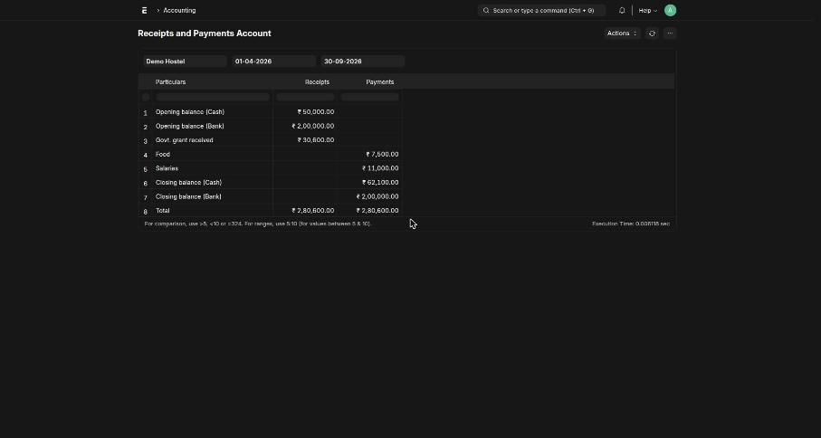

---

## 4. Once a year: results and promotion

### 4.1 Result Sheet of Inmates
After the Final exam: new **Result Sheet of Inmates**, the hostel, the academic year, the exam **Final**. Click **Fill Students**. Every enrolled girl appears with the maximum marks for her class (from the Trust Class: 480 for classes 6 to 9, 625 for class 10). Enter marks and the result (Pass, Fail, Absent). The **Promotion Action** fills itself:

| Result | Action it suggests | Other choices |
|---|---|---|
| Pass, class below the last | Promote | |
| Pass, last class (10) | Complete (choose where she goes next) | |
| Fail, any class | Repeat | **Left with T.C.** |
| Absent | blank: you choose | |

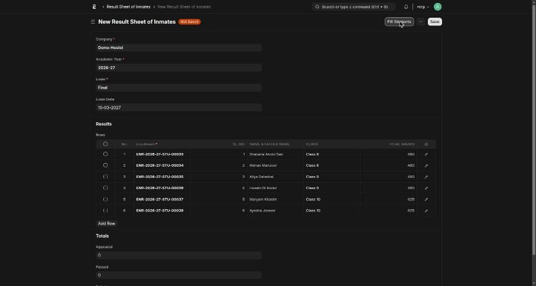

### 4.2 Submit, then Promote
Submit the sheet. A **Promote** button appears. Click it and confirm. For each girl the system makes next year's enrollment with status **Planned** (promoted girls in the next class; a repeating girl in the same class), closes a girl who completed (**Passed Out**) or **Left with T.C.**, and marks the sheet as done. It can be done only once.

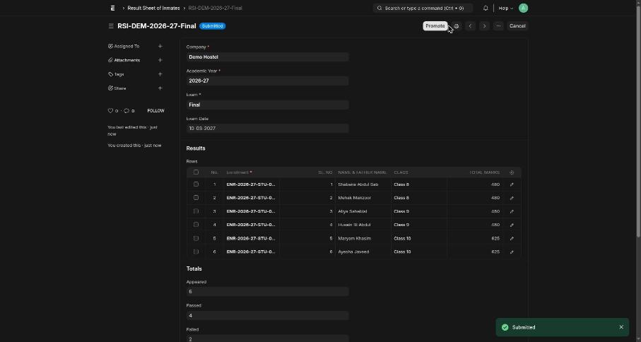
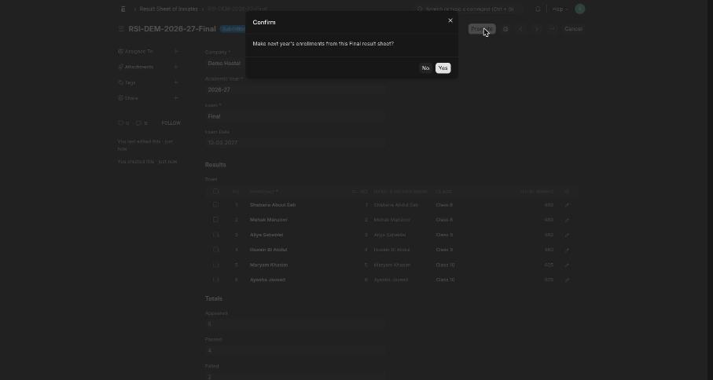

Here: Shabana and Mehak move to class 9, Husain to class 10, Aliya repeats class 9, Maryam completes class 10, and Ayesha (failed class 10) leaves with a T.C.

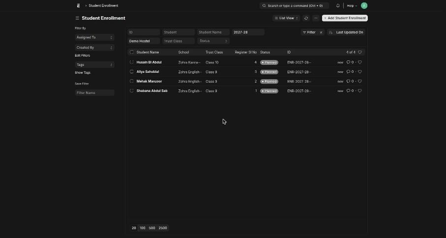
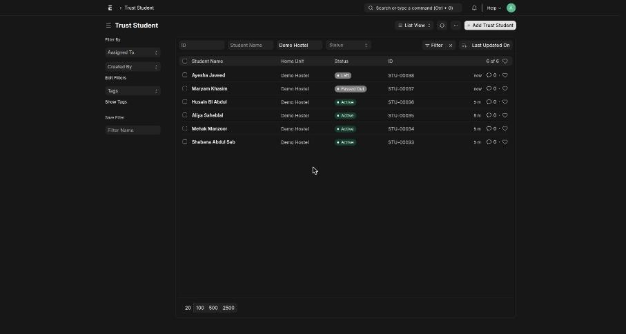

When the Transfer Certificate is issued, open the student and fill **T.C. number** and **T.C. date**.

At the start of the new year, open each Planned enrollment and change the status to **Enrolled** to confirm the girl is back.

---

## 5. Every half-year: the Report Pack

The report for the Minority department is built from all of the above.

### 5.1 Make the pack
New **Report Pack**: the hostel, from date 1 April, to date 30 September. Save. It lists the pages in filing order: Letter, Receipts and payments, Abstract of attendance, Food expenditure statements, Appendix – H, List of officer bearer, List of staff, Result sheet, School: College attendance registers (Kannada).

- Untick **Include** to leave a page out. Drag a row to change its order.
- To add a page that is not generated (the CA's balance sheet, the building plan, a signed scan), add a row, choose **Uploaded page**, give it a title and attach the PDF, PNG or JPG. Put the row where it should print.
- **Standard Pages** puts the list back to the default.
- The staff list comes from the hostel's active **Employee** records (name, designation and qualification). Add staff there.
- The Grant Bill is not in the pack yet; its format is still to come from Zohra.

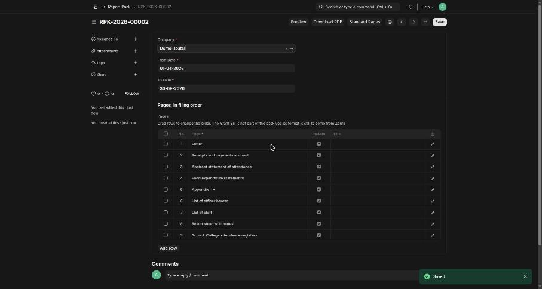

### 5.2 Preview and download
Click **Preview**. A window opens with the pack as it is right now. The orange box lists what to fix before filing: a month with no submitted attendance or food statement, no staff records, a missing uploaded file. April and May are never listed. Fix the entry, click Preview again. When it is clean, click **Download PDF** and print.

**A pack that is not ready.** The first time we previewed, only June had been entered. The orange box listed July, August and September, and there were no staff yet:

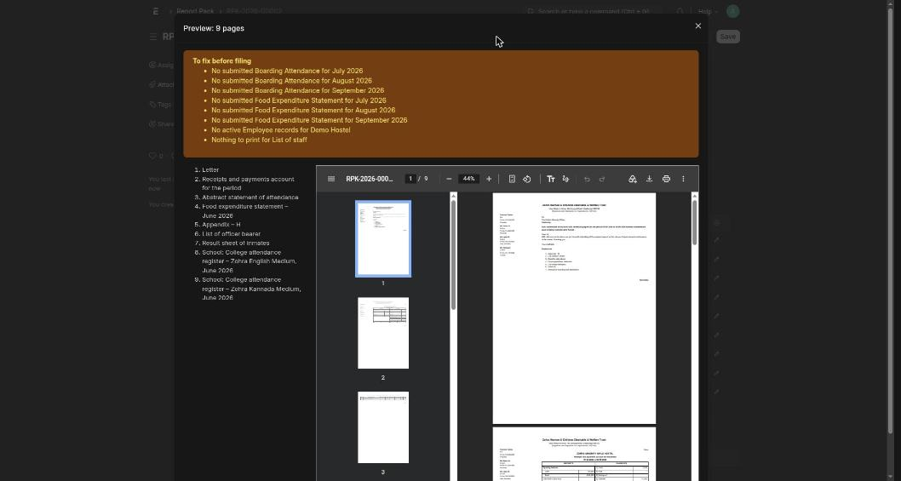

After the staff records were added only the three missing months remained:

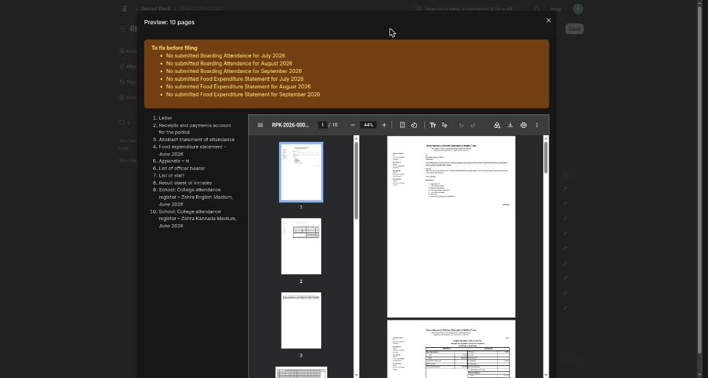

**A complete pack.** After July, August and September were entered the same way as June (purchases, kitchen use, salaries, attendance, food statement), the box disappears and the pack is 19 pages:

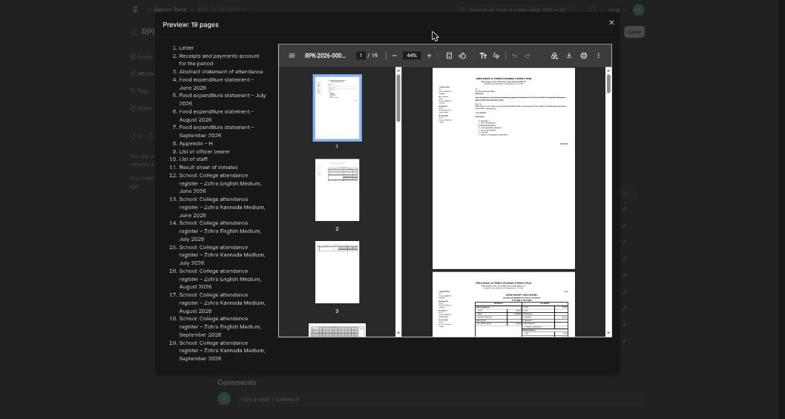

### 5.3 What the finished report looks like
`Zohra_half_yearly_report_DEMO.pdf` (in the same folder as this guide) is the full 19-page pack from the run: letter, receipts and payments, abstract, four food statements, Appendix – H, officer bearers, staff, result sheet and eight attendance registers (two schools, four months). Sample pages:

Receipts and Payments account (both sides total ₹2,80,600: food ₹30,300, salaries ₹44,000, closing cash ₹6,300, bank ₹2,00,000):

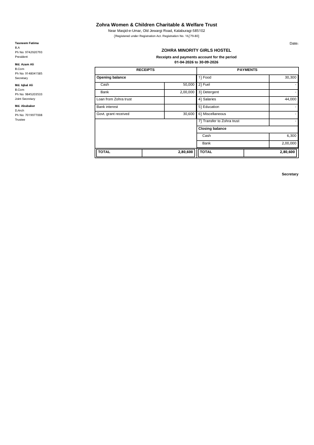

Attendance abstract:

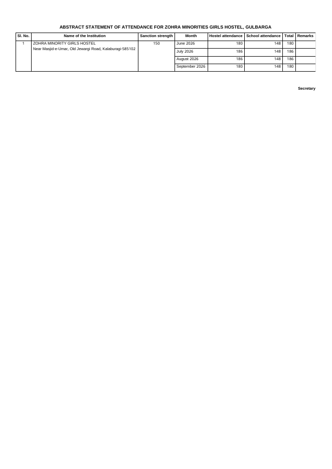

Food expenditure statement for June (one page per month, landscape):

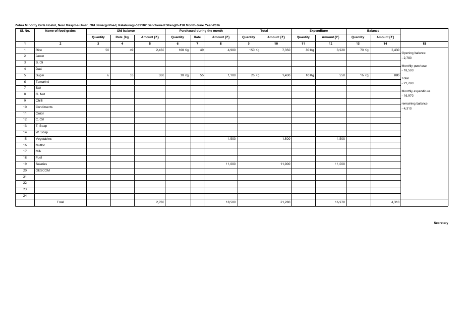

School attendance register (Kannada heading; one per school and month):


The data is dummy: six girls, small quantities. The layout and the way every number is built are the real ones.

---

## 6. Fixing a mistake

- **Draft:** just edit and Save.
- **Submitted:** click **Cancel** on that document, confirm, then **Amend** to make a corrected copy. Cancelling a Material Consumption puts the food back in stock; cancelling a Cash Bank Voucher removes its journal entry. A user can cancel only their own entries, and only for the number of days set in Trust Settings (1 by default); the Principal can cancel anyone's.
- **A month already closed** by the Principal (Accounting Period) refuses new entries.

## 7. If the system stops you

The wording on screen may differ a little from these lines.

| Message | What to do |
|---|---|
| Sanctioned strength reached | The hostel is full. Free a seat, or ask for a new Unit Sanction row. |
| Row 1: Hostel Days must be between 0 and 30 | Correct that girl's days. |
| A document for that month or day already exists | Open the existing one. |
| Statement balance differs from stock | Check the month's consumption and purchases, or the physical count. |
| Leaving Destination is required | Choose where a girl who completed class 10 goes next. |
